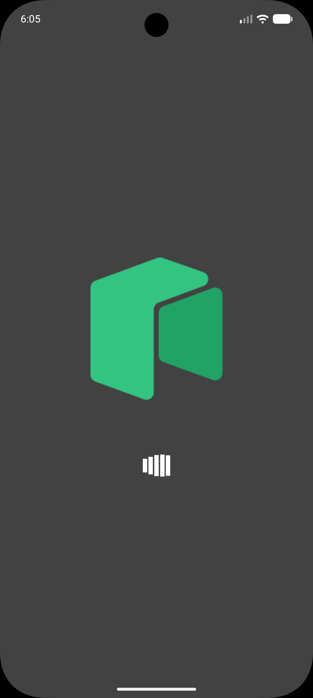
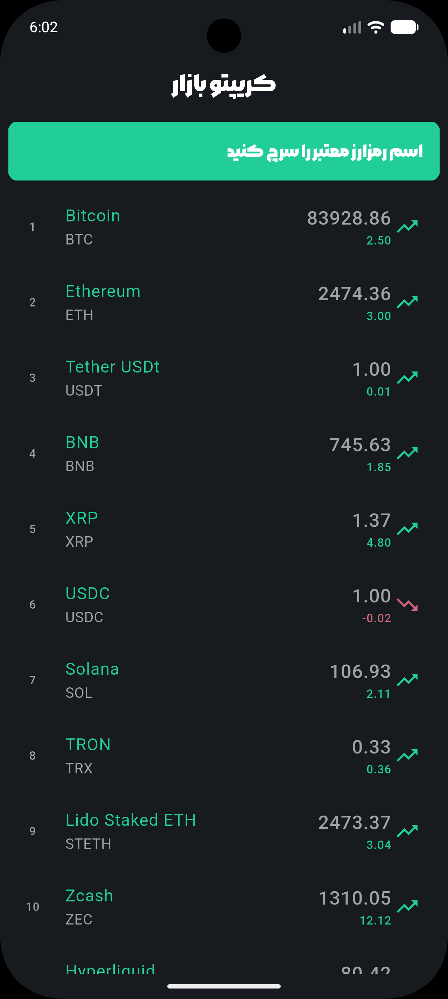
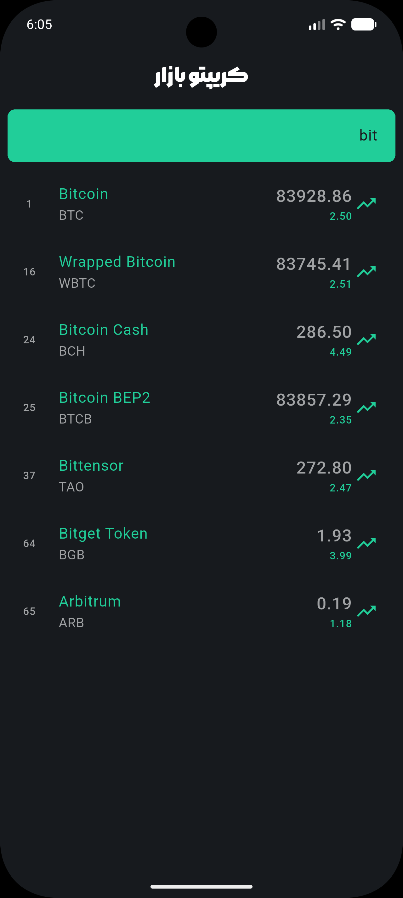
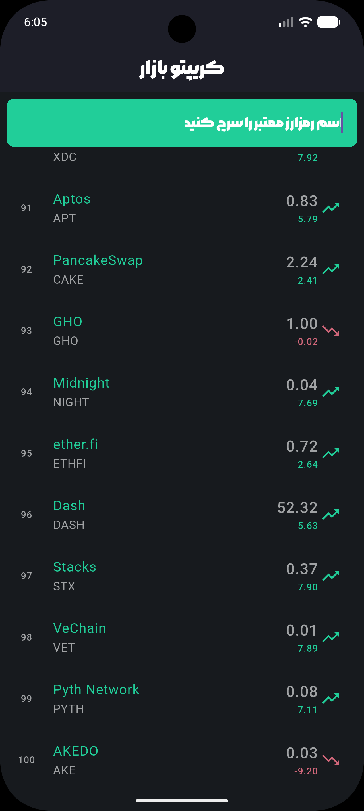
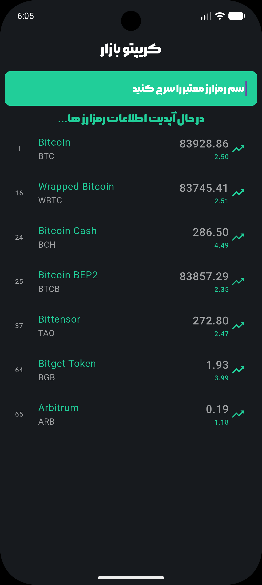
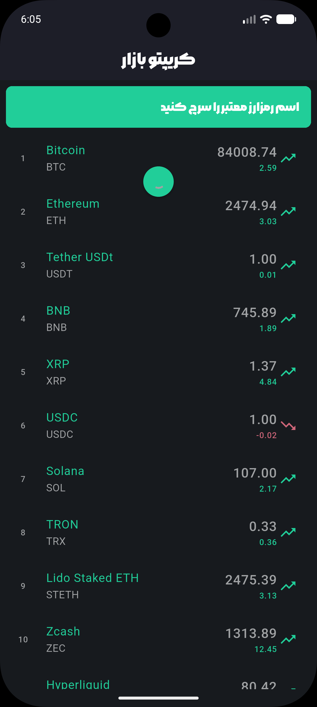

[English](README.md) | [فارسی](README.fa.md)

# Crypto Bazzar


A small Flutter app for browsing cryptocurrency prices in a dark interface, with Persian labels, name search, and pull-to-refresh.

**Current status:** the screens and data parsing are implemented, but both HTTP requests still use the literal placeholder `API key` as their URL. Configure a compatible market-data API before running the app; it does not fetch prices out of the box.

## Screenshots

The screenshots below show the splash screen, coin list, name search, and data-refresh states. Original images are stored in `assets/screenshots/`.

| Splash screen | Coin list | Name search |
| :---: | :---: | :---: |
|  |  |  |

| Coin list (scrolled) | Updating data | Pull-to-refresh |
| :---: | :---: | :---: |
|  |  |  |

These images are for documentation only; they do not need to be added to Flutter's asset list in `pubspec.yaml`.

## Key features

Once the API requests are configured, the app provides:

- A logo splash screen with a `SpinKitWave` loading indicator while the initial market data is fetched.
- A scrolling list showing each coin's name, symbol, rank, USD price, and 24-hour percentage change.
- Prices and percentage changes displayed to two decimal places, with green/upward and red/downward indicators for price movement.
- Case-insensitive search by coin name.
- Pull-to-refresh to request a fresh list of coins.
- A dark color palette, Persian interface labels, an RTL search field, and bundled custom fonts.

This is a market-list app, not a trading client. Charts, coin-detail pages, favorites, portfolios, and offline storage are not implemented. The model also parses market capitalization, but the list does not display it.

## Tech stack & architecture

The project uses a simple screen-based structure, not Clean Architecture or MVVM. Networking and UI state currently live in the screen widgets, with a separate data model and shared color constants.

```text
lib/
├── main.dart                    # Application entry point and MaterialApp
├── data/
│   ├── constant/
│   │   └── constants.dart       # Shared colors
│   └── model/
│       └── crypto.dart          # Crypto model and JSON parsing
└── screens/
    ├── splash_screen.dart      # Initial request, loading UI, and navigation
    └── coin_list_screen.dart   # Coin rows, search, and refresh
```

**State Management:** `StatefulWidget`, `initState`, and `setState`. There is no BLoC, Provider, Riverpod, repository layer, or local database.

**Data flow:** `main.dart` opens `SplashScreen`. The splash screen fetches a response, converts `response.data['data']` into `Crypto` objects, and passes the list to `CoinListScreen`. The list screen makes its own requests for refresh and when the search query is cleared. Parsing is handwritten in `Crypto.fromMapJson`; no generated models are used.

### Packages

The direct dependencies declared in `pubspec.yaml` are:

- **Flutter SDK** — Material widgets, navigation, and built-in state management.
- **`dio: ^5.11.1`** — HTTP requests for market data.
- **`flutter_spinkit: ^5.2.2`** — splash-screen loading animation.
- **`cupertino_icons: ^1.0.8`** — Cupertino icon dependency.

Development dependencies:

- **`flutter_test`** — Flutter's testing framework.
- **`flutter_lints: ^6.0.0`** — the lint rules included by `analysis_options.yaml`.

Bundled assets include `assets/images/logo.png` and the `mr` and `iranYekan` font families, backed by `assets/fonts/mh.ttf` and `assets/fonts/iyl.ttf`. Screens currently reference the `mr` family.

### Project metadata

- Package name: `crypto_bazzar`.
- Version: `1.0.0+1`.
- Manifest description: `A new Flutter project.` — still the scaffold description.
- Dart SDK constraint: `^3.12.0`, meaning Dart **3.12.0 or later, below 4.0.0**.
- `publish_to: 'none'`: package publishing is disabled.
- Runner directories exist for Android, iOS, web, Windows, macOS, and Linux. Their presence does not establish that the app has been tested on every platform.

## Getting started

### 1. Prepare the environment

Install a Flutter SDK that includes Dart 3.12.0 or newer within the constraint above, plus the toolchain for your target platform. Use an Android emulator, a connected device, or another configured Flutter target.

```bash
flutter --version
flutter doctor
```

The lockfile records a Flutter lower bound, but the chosen Flutter installation must also satisfy the project's Dart constraint. There is no exact Flutter SDK version pinned in `pubspec.yaml`.

### 2. Clone the repository

```bash
git clone https://github.com/mehrshadkhv/crypto-bazzar.git
cd crypto-bazzar
```

If you already have a local checkout, use that directory instead.

### 3. Install dependencies

```bash
flutter pub get
```

There is no `build_runner`, `freezed`, or `json_serializable` dependency, so no application code-generation command is required.

### 4. Configure market-data requests

Replace the literal `API key` passed to `Dio().get(...)` in **both** locations:

- `lib/screens/splash_screen.dart` — `getData()`.
- `lib/screens/coin_list_screen.dart` — `_getData()`.

The comments refer to CoinCap, but no working endpoint or authentication is configured. Use a valid endpoint from your chosen provider and follow its current authentication requirements. An API token is not itself a URL: put the endpoint in the request URL and, if required, configure authentication separately through Dio's request options. Do not commit private tokens.

The current parser expects a JSON object with a `data` array. Each item must contain `id`, `name`, `symbol`, `rank`, `priceUsd`, `changePercent24Hr`, and `marketCapUsd`. The numeric fields are parsed from strings. Keep the exact key spelling, including `changePercent24Hr`; if your provider returns different names, types, or structure, update `Crypto.fromMapJson` and the response mapping in both screens.

Internet access is required. There is no mock dataset or offline fallback.

### 5. Run the app

```bash
flutter devices
flutter run
```

To choose a specific target:

```bash
flutter run -d <device-id>
```

### Platform configuration before release

- **Android:** the main manifest has no `INTERNET` permission; it is currently declared only in debug/profile manifests. Add the following directly under the root `manifest` element of `android/app/src/main/AndroidManifest.xml`, outside `application`, for release networking:

  ```xml
  <uses-permission android:name="android.permission.INTERNET" />
  ```

  The application ID is still `com.example.crypto_bazzar`, and release builds use debug signing. Configure the app identity and proper release signing before distribution. The Android build files target Java/Kotlin 17.
- **macOS:** the sandboxed entitlements do not include `com.apple.security.network.client`. Review the debug/profile and release entitlement files before making outbound API requests.
- **Web:** the API must allow requests from the app's browser origin through CORS.
- **iOS and desktop targets:** use the platform-specific Flutter toolchain and validate behavior on the actual target; runner scaffolding alone is not a support guarantee.

## Checks & current limitations

Static analysis can be run with:

```bash
flutter analyze
```

The repository contains `test/widget_test.dart`, but it is still the generated counter test: it expects `0`, `1`, and an add button rather than the crypto screens. Update or replace it with relevant tests before treating the test suite as a useful verification step. The test command is:

```bash
flutter test
```

Other limitations worth knowing when extending the app:

- API failures and malformed responses have no dedicated error screen or retry flow; the splash request can leave the app on its loading screen.
- Search filters the currently displayed list rather than a separate original dataset. Clearing the query refetches data, so broadening a non-empty query may not restore previously filtered coins.
- Async requests do not have mounted checks or request cancellation.
- There is no pagination, custom sorting, or persistent cache.

## License

No `LICENSE` file is included in this checkout. The badge reflects that status; this README does not assign a license. Add a license file if you intend to specify terms for reuse or distribution.
